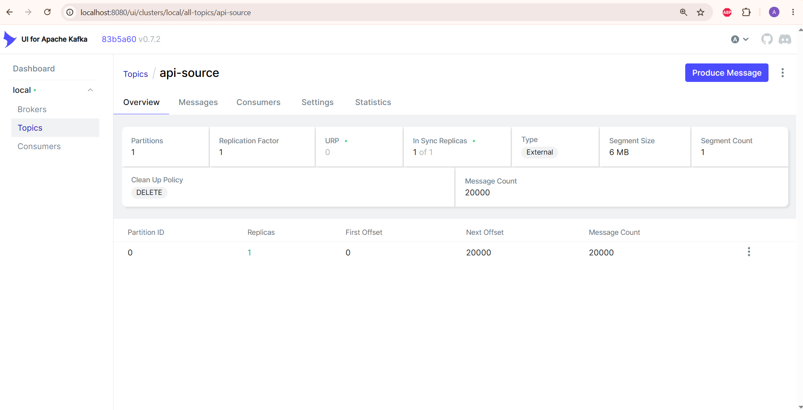
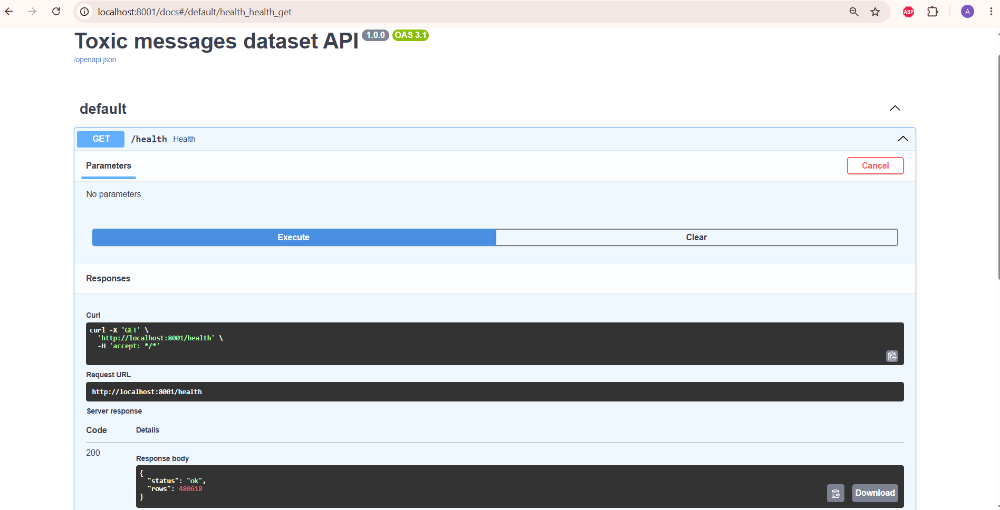

# ДЗ-1. ETL из REST API в Postgres (+ Kafka)

Задание - переработанный старый [репо](https://github.com/AI-25-HSE-Team-18/toxic-messages-infra)

## П.1. Источник данных

**Тема датасета**<br> Классификация токсичности текстов<br><br>
**Причина выбора**<br> Переиспользовать **фрагмент датасета**, который собирался вручную из разных источников и документировался слишком подробно год назад для Годового проекта <br><br>
**Чтение и формат**<br> В исходной версии датасет загружался в yandex-cloud на базе MinIO, api тот же. И использовался в реалтайм-демонстраторе классификатора токсичности текстов.  
В данном задании чтение датасета упрощено до локального `csv-файла`, который отдается через **REST API** (`dataset-api`, FastAPI в docker) в сочетании с микро-версией Kafka.  
<br>
[Состав общего датасета](https://docs.google.com/spreadsheets/d/1nKGy5kra3vlceI4pu0fY7Glpdm16JUDU0stc1W4JV5s/edit?gid=0#gid=0) (он же `data/Datasets.xlsx`)

**Файл**`data/sample_dump_features.csv` - фрагмент, чтобы влез в git<br>
**Состав** 5000 строк, API берет его<br>

**Схема** (только сырые и числовые колонки):
* `raw_text_id` (int), `dataset_id` (int), `source_platform` (str), `is_verified` (0/1)
* `text_raw` (str), `is_toxic` (0/1/null), `toxicity_type` (str)
* `count_spp`, `count_rpp`, `count_profanity` (int), 9 флагов `has_emoji`, `has_url`, ... (0/1)

**Endpoints** 
* `/messages?offset=&limit=` (данные постранично), `/health`, `/schema`, `/docs`

Пример обращения к датасету: 
```
GET http://localhost:8001/messages?offset=0&limit=1
```
-> 
```json
{"total": 5000, "offset": 0, "limit": 1, "items": [{"raw_text_id": 0, "dataset_id": 0, "source_platform": "2ch, pikabu", "is_verified": 1, "text_raw": "Верблюдов-то за что? Дебилы, бл...\n", "is_toxic": 1.0, "toxicity_type": null, "count_spp": 3, "...": "..."}]}
```

## П.2. Целевая БД и инфраструктура

**Postgres 16**, `init/init.sql` создает схему `toxicity`:
* `toxicity.messages` - поля выше + `text_length`, `loaded_at`; PK `raw_text_id`, флаги `boolean`, `is_toxic` `smallint`

**docker-compose состав** 
* postgres
* dataset-api
* zookeeper
* kafka
* kafka-init (топик `api-source`)
* kafka-ui
* etl (one-shot, запускает `notebooks/etl.ipynb` внутри docker)

## Архитектура

1. Ноутбук забирает данные из `dataset-api`, чистит и пишет в `toxicity.messages`
2. Новые строки также уходят в Kafka-топик `api-source` (см. kafka-ui)

Повторный запуск дублей не создает: `ON CONFLICT DO NOTHING`, в Kafka уходят только новые строки
<br><br>
# Как запустить

Все в docker, локальный python не нужен:
```bash
git clone https://github.com/DelWoods/DE-hw1-temppublic.git && cd DE-hw1-temppublic
cp .env.example .env
docker compose up -d --build --wait

# run notebooks/etl.ipynb top to bottom in the etl container (outputs are saved into the file):
docker compose run --rm --build etl

# count Postgres rows: 
docker exec -it postgres psql -U etl_user -d toxicity -c "SELECT COUNT(*) FROM toxicity.messages;"

# print first rows: 
docker exec -it postgres psql -U etl_user -d toxicity -c "SELECT raw_text_id, dataset_id, source_platform, is_toxic, left(text_raw, 60) AS text_raw, text_length FROM toxicity.messages ORDER BY raw_text_id LIMIT 5;"
```
* kafka-ui http://localhost:8080
* dataset-api http://localhost:8001/docs

## Результат (последняя ячейка, слишком-неуместные примеры удалены)

```
INFO - Postgres: 5000 new rows, 0 already existed
INFO - Kafka: 5000 messages sent to api-source

    cnt
0  5000

   raw_text_id  dataset_id source_platform  is_toxic toxicity_type                                           text_raw  text_length
0            0           0     2ch, pikabu         1                               Верблюдов-то за что? Дебилы, бл...
           35
2          192           0     2ch, pikabu         1                  Религиозным можно быть по-разному. Я не говорю...          305
3          288           0     2ch, pikabu         0                    У тебя в домашке мало букв, а мне надо много.
           46
```
Повторный запуск: `Postgres: 0 new rows, 5000 already existed`, `Kafka: nothing new to send`.

## Скриншоты развернутых Кафки и api

<figure>
  
  <figcaption>Живая Кафка</figcaption>
</figure>

<figure>
  
  <figcaption>Живой api</figcaption>
</figure>

<br><br>
# Что можно улучшить

* `Избыточность`: держим в голове, что Kafka в докере и с api сервисом для микро-датасета на 5000 строк **на одной машине** - очень избыточно и это лишь демонстраторы, чтобы поработать с фреймворками и лучше понимать, как работать в проде
* Outbox-таблица: сейчас при падении Kafka после вставки в PG строки в топик не попадут